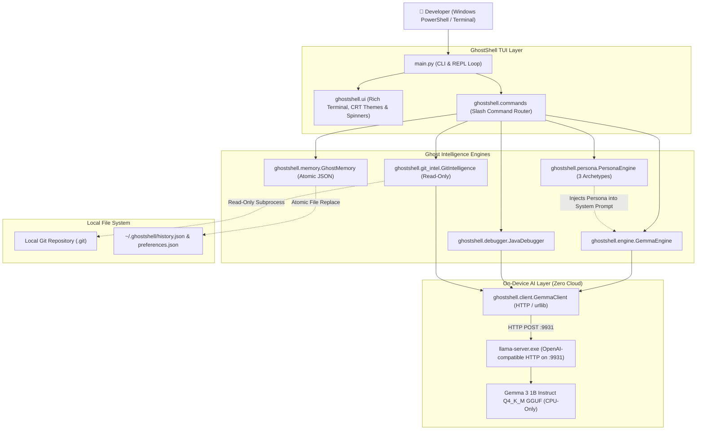

# 👻 GhostShell — The Terminal That Remembers

> **A spooky, local-first AI developer assistant for the Hacktoberfest “Ghost in the Machine” open-source AI challenge.**

```text
        .-"-.     _____ _               _   ____  _          _ _ 
       /     \   / ____| |             | | / ___|| |        | | |
      | () () | | |  __| |__   ___  ___| |_\___ \| |__   ___| | |
       \  ^  /  | | |_ | '_ \ / _ \/ __| __|___) | '_ \ / _ \ | |
        |||||   | |__| | | | | (_) \__ \ |_|____/| | | |  __/ | |
       '-----'   \_____|_| |_|\___/|___/\__|     |_| |_|\___|_|_|

    ⚡ GHOST IN THE MACHINE • LOCAL-FIRST AI COMPANION • v1.0 MASTER ⚡
```

GhostShell is a haunted terminal companion that observes your command history, Git activity, and coding mistakes, translating them into eerie, intelligent commentary from a fictional ghost dwelling inside your machine.

Powered by **Google Gemma 3 1B Instruct** via local `llama.cpp`, GhostShell runs **100% on-device with zero cloud telemetry**, engineered specifically for 8 GB RAM Windows laptops without dedicated GPUs.

---

## 🔮 Core Subsystems & Features

### 1. 👻 Possessed Java Debugger (`/debug`)
- **Five Structured Exorcism Sections:**
  1. **👻 Ghost's Whisper:** Eerie one-liner from the machine apparition.
  2. **Root Cause:** Pinpoints exact defect (loop variable increment mismatches, `NullPointerException`, array bounds, missing syntax).
  3. **Corrected Code:** Complete, clean Java code snippet formatted with rich syntax highlighting.
  4. **Explanation:** Why the fix works, with special diagnosis for treacherous loop bugs (e.g. `for (int col = 1; col <= row; row++)`).
  5. **Verification:** Step-by-step instructions on how to compile and test the fix.
- **Multiline & Inline Input Modes:** Type `/debug` for interactive multiline input with `:done` / `:cancel` controls, or `/debug <code>` for quick one-liners.
- **Ambiguity Guard:** Incomplete code fragments trigger requests for missing context instead of hallucinating fixes.

### 2. 📜 Machine Memory & Git Intelligence (`/git`, `/story`, `/review`)
- **Read-Only Subprocess Security:** Inspects Git logs and working-tree status via argument arrays (`shell=False`). Never stages, commits, pushes, or alters repositories.
- **Gothic Commit Lore (`/story`):** Weaves eerie short stories strictly grounded in authentic commit hashes and author messages.
- **Activity Review (`/review`):** Cautious high-level development velocity review assessing branch momentum and commit hygiene.

### 3. 🧠 Private Local Memory (`/history`, `/forget`, `/storage`)
- **Zero Cloud Storage:** Conversation history and preferences reside strictly on the local machine in `~/.ghostshell/` using human-readable JSON.
- **Atomic Replacement:** Safe file-replacement techniques (`os.replace`) prevent file corruption during sudden interrupts.
- **Total Erasure (`/forget`):** Purges all local history and preference files on demand.

### 4. 🎭 Ghost Personality Matrix (`/persona`, `/theme`)
- **Three Spectral Archetypes:**
  - `archivist`: Reflective, solemn, mysterious; views code through ancient digital history.
  - `poltergeist`: Playful, mischievous, chaotic; teases bugs while offering sharp fixes.
  - `grim-debugger`: Direct, cynical, deadpan; zero fluff, instant technical diagnosis.
- **Dynamic Palette Shifting (`/theme`):** Switch between `green` (classic CRT phosphor), `amber` (retro amber display), `cyan` (spectral ice), and `monochrome`.

### 5. 🛡️ Sandboxed Safety Model
- **Command Execution Forbidden:** `ALLOW_COMMAND_EXECUTION` is hardcoded to `False` and immutable. GhostShell never invokes shell commands or Java code automatically.
- **Untrusted Input Boundaries:** Java code, compiler logs, and Git history are enclosed in strict delimiters to mitigate prompt injection.
- **Non-Local Endpoint Alert:** Warns prominently before transmitting prompts if an external network endpoint is configured.

---

## 🏗️ Architecture Diagram



---

## 📂 Project Structure

```text
GhostShell/
├── main.py                     # Entry point & interactive REPL loop
├── requirements.txt            # Python package dependencies (Rich, Pytest)
├── .gitignore                  # Git ignore rules for Python & environments
├── LICENSE                     # MIT License
├── README.md                   # Complete documentation & Windows setup guide
├── CONTRIBUTING.md             # Developer contribution guidelines & invariants
├── SUBMISSION.md               # Hacktoberfest Week 3 Challenge submission post
├── DEMO.md                     # Live demonstration walkthrough script
│
├── ghostshell/                 # Core GhostShell package
│   ├── __init__.py             # Exports & version metadata (v1.0.0)
│   ├── client.py               # Lightweight HTTP client for local llama.cpp endpoint
│   ├── config.py               # Themes, model endpoints, and security invariants
│   ├── ui.py                   # Rich terminal UI, ASCII banners, panels, spinner & syntax
│   ├── commands.py             # Slash command registry (/help, /debug, /git, /persona...)
│   ├── debugger.py             # Possessed Java Debugger & 5-section parser
│   ├── git_intel.py            # Phase 4 Git Intelligence (read-only subprocess)
│   ├── memory.py               # Phase 5 Private Local Memory (atomic JSON store)
│   ├── persona.py              # Phase 6 Ghost Personality Engine & Theme Palettes
│   └── engine.py               # Response engines (GemmaEngine & PlaceholderEngine)
│
└── tests/                      # Automated test suite (115 passing tests)
    ├── __init__.py
    ├── test_client.py          # Mocked HTTP client tests (success, offline, timeouts)
    ├── test_commands.py        # Slash command parsing and model probe tests
    ├── test_config.py          # Configuration and security immutability tests
    ├── test_debugger.py        # Java debugger unit tests (loop bugs, ambiguity, fallback)
    ├── test_engine.py          # GemmaEngine and PlaceholderEngine unit tests
    ├── test_git_intel.py       # Git intelligence unit tests (subprocess mocks)
    ├── test_integration.py     # End-to-end mock server integration test
    ├── test_memory.py          # Local memory unit tests (persistence, corruption recovery)
    ├── test_new_commands.py    # Phase 4-7 command tests & endpoint safety checks
    ├── test_persona.py         # Personality & theme switching unit tests
    ├── test_repl.py            # REPL loop, signal handling (Ctrl+C, EOF) tests
    ├── test_resize_and_move.py # Terminal resize & move signal resiliency tests
    ├── test_security.py        # Strict command execution prevention tests
    └── test_ui.py              # Visual UI rendering, syntax highlighting & multiline prompt tests
```

---

## 🚀 Windows PowerShell Setup Instructions

### 1. Prerequisites
- **Python 3.10+** (Tested on Python 3.10 through 3.14)
- **Windows PowerShell** or **Windows Terminal** (recommended for TrueColor support)
- **Git**

### 2. Clone and Setup Environment
Open Windows PowerShell in your projects directory:

```powershell
git clone https://github.com/RudraBhullar/GhostShell.git
cd GhostShell

# Create and activate virtual environment
python -m venv venv

# If execution policy blocks script activation:
Set-ExecutionPolicy -ExecutionPolicy RemoteSigned -Scope Process

.\venv\Scripts\Activate.ps1

# Install lightweight dependencies
pip install -r requirements.txt
```

---

### 3. Setting Up Local Gemma 3 1B via `llama.cpp`

GhostShell connects to the local OpenAI-compatible server at `http://127.0.0.1:9931`. Here is the recommended setup for an 8 GB RAM Windows laptop without a dedicated GPU:

#### Step A: Download `llama.cpp` for Windows
1. Download the latest Windows release (`llama-bXXXX-bin-win-avx2-x64.zip` or `llama-server.exe`) from the [llama.cpp GitHub releases](https://github.com/ggerganov/llama.cpp/releases).
2. Extract `llama-server.exe` into a folder (for example, `C:\llama.cpp\`).

#### Step B: Download Gemma 3 1B Instruct GGUF
Download the `Q4_K_M` quantization of Gemma 3 1B Instruct (~1.0 GB):
- **Model:** `gemma-3-1b-it-Q4_K_M.gguf`
- Place it in a `models/` directory:
```powershell
New-Item -ItemType Directory -Force -Path models
# Download the model GGUF (e.g., from Hugging Face):
# https://huggingface.co/google/gemma-3-1b-it-GGUF
```

#### Step C: Start the Local Model Server
In a separate PowerShell window, start `llama-server` on port `9931`:
```powershell
.\llama-server.exe -m .\models\gemma-3-1b-it-Q4_K_M.gguf --port 9931 -c 2048 -ngl 0
```
> **Tip for 8 GB RAM Laptops:** `-ngl 0` ensures 100% CPU inference, keeping GPU VRAM clear and total memory footprint at ~1.8 GB.

---

### 4. Launching GhostShell

Once your virtual environment is active, start GhostShell:

```powershell
# Standard launch
python main.py

# Launch without boot animation
python main.py --no-animation

# Launch with custom endpoint or model
python main.py --endpoint http://127.0.0.1:9931/v1/chat/completions --model gemma-3-1b-it

# Launch with memory disabled (zero disk persistence)
python main.py --no-memory

# Launch with specific persona or theme
python main.py --persona poltergeist --theme amber

# Launch in Phase 1 standalone UI Dev mode (no model required)
python main.py --placeholder
```

---

## 📜 Built-in Slash Commands

| Command | Usage | Description | Aliases |
| :--- | :--- | :--- | :--- |
| `/debug` | `/debug [code]` | Invoke the Possessed Java Debugger for multiline/inline code. | `/javadebug` |
| `/git` | `/git [count]` | Summarize the most recent commit records from repository memory. | `/commits`, `/log` |
| `/story` | `/story [count]` | Weave an eerie gothic tale grounded strictly in real commit logs. | `/gitstory` |
| `/review` | `/review [count]` | Cautious high-level development velocity and commit hygiene review. | `/gitreview` |
| `/githelp` | `/githelp` | Display quick guide for all repository intelligence rites. | — |
| `/history` | `/history [limit]` | Inspect recent conversation turns preserved in private local memory. | `/hist` |
| `/forget` | `/forget` | Purge all persistent conversation history and local preference files. | `/purge` |
| `/storage` | `/storage` | Inspect local storage paths, file sizes, and privacy disclosure. | `/privacy` |
| `/persona` | `/persona [name]` | Inspect or shift active persona (`archivist`, `poltergeist`, `grim-debugger`). | `/personality` |
| `/theme` | `/theme [name]` | Inspect or shift color theme (`green`, `amber`, `cyan`, `monochrome`). | `/colors` |
| `/status` | `/status` | Inspect conduit health, model server, Git repository, and locks. | `/diag` |
| `/model` | `/model` | Inspect local model endpoint, name, and connection status. | `/gemma` |
| `/clear` | `/clear` | Banish previous screen spirits and refresh the viewport. | `/cls` |
| `/exit` | `/exit` | Release the ghost and return safely to host OS. | `/quit`, `/q` |
| `/about` | `/about` | View the lore behind the Ghost in the Machine challenge. | — |
| `/help` | `/help [command]` | Summon the grimoire of available rites and commands. | `/?` |

---

## 🧪 Automated Test Suite

GhostShell includes **115 automated unit and integration tests** using mocked HTTP responses and simulated local repositories, requiring **zero model downloads** to run:

```powershell
pytest -v
```

```text
============================= test session starts =============================
platform win32 -- Python 3.14.7, pytest-9.1.1, pluggy-1.6.0
rootdir: G:\Hacktober'26\GhostShell
collected 115 items

tests/test_client.py .......                                             [  6%]
tests/test_commands.py ............                                      [ 16%]
tests/test_config.py ......                                              [ 21%]
tests/test_debugger.py ......                                            [ 26%]
tests/test_engine.py .......                                             [ 33%]
tests/test_git_intel.py ...........                                      [ 42%]
tests/test_integration.py .                                              [ 43%]
tests/test_memory.py .........                                           [ 51%]
tests/test_new_commands.py ...........                                   [ 60%]
tests/test_persona.py ......                                             [ 66%]
tests/test_repl.py .......                                               [ 72%]
tests/test_resize_and_move.py ...............                            [ 85%]
tests/test_security.py ..                                                [ 86%]
tests/test_ui.py ...............                                         [100%]

============================= 115 passed in 3.55s =============================
```

---

## 💡 Troubleshooting & Common Issues

- **Connection Refused (`http://127.0.0.1:9931`):** Ensure `llama-server.exe` is running on port 9931. Check with `Get-Process llama-server`.
- **Generation Timeout on Slow CPUs:** Adjust the timeout via environment variable:
  ```powershell
  $env:GHOSTSHELL_MODEL_TIMEOUT = "90.0"
  ```
- **Permission Denied in `~/.ghostshell`:** Set a custom data directory:
  ```powershell
  $env:GHOSTSHELL_DATA_DIR = "C:\GhostShellData"
  ```
- **Terminal Encoding / Glitches:** GhostShell automatically calls `enable_windows_virtual_terminal()`. Use **Windows Terminal** for the best TrueColor CRT glow experience.

---

## 📄 License & Attribution

- **GhostShell Codebase:** Released under the [MIT License](LICENSE).
- **Gemma 3:** Developed by Google, governed by the [Gemma Terms of Use](https://ai.google.dev/gemma/terms).
