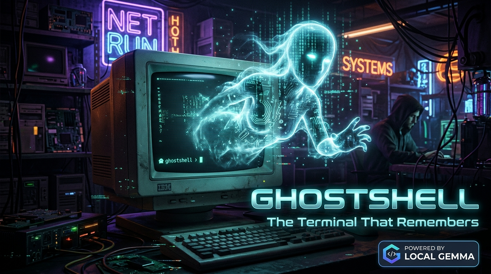
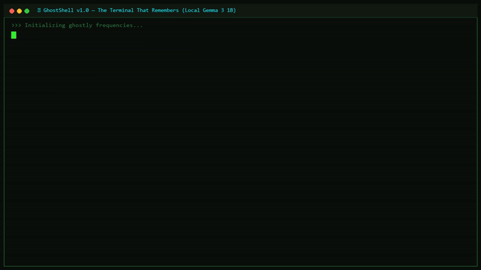

*This is a submission for the [Hacktoberfest Open-Source AI Challenge Week 4: Ghost in the Machine](https://dev.to/challenges/hacktoberfest-week4-2026-10-26)*



## What I Built

**GhostShell — The Terminal That Remembers** is a spooky, local-first AI developer assistant engineered for the terminal. Dwelling directly inside the developer's machine, GhostShell observes coding activity, Git history, and syntax errors, translating them into eerie, witty, and razor-sharp commentary from a fictional ghost trapped within the silicon.

```text
        .-"-.     _____ _               _   ____  _          _ _ 
       /     \   / ____| |             | | / ___|| |        | | |
      | () () | | |  __| |__   ___  ___| |_\___ \| |__   ___| | |
       \  ^  /  | | |_ | '_ \ / _ \/ __| __|___) | '_ \ / _ \ | |
        |||||   | |__| | | | | (_) \__ \ |_|____/| | | |  __/ | |
       '-----'   \_____|_| |_|\___/|___/\__|     |_| |_|\___|_|_|

    ⚡ GHOST IN THE MACHINE • LOCAL-FIRST AI COMPANION • v1.0 MASTER ⚡
```

### The Concept & Inspiration
In classic philosophy and sci-fi lore, the *"Ghost in the Machine"* refers to consciousness arising unexpectedly from mechanical hardware. We asked ourselves: *What if the ghost inside your computer wasn't just a metaphor, but an active, intelligent terminal presence that watches your commits, remembers your debugging struggles, and speaks to you from the phosphor glow of your screen?*

Instead of building another generic chatbot wrapper or browser tab, we built an authentic, retro-futuristic terminal companion with dark phosphor CRT styling, green phosphor glow, and deep local-first intelligence.

### Key Capabilities

1. **👻 Possessed Java Debugger (`/debug`):**
   - Diagnoses compiler errors, null pointers, array bounds, type mismatches, and insidious control-flow bugs.
   - Accepts multiline Java code and compiler logs with interactive `:done` / `:cancel` controls.
   - Special diagnosis for the classic runaway loop trap: `for (int col = 1; col <= row; row++)`, where the inner loop increments the outer variable.
   - Returns 5 structured Rich panels: **Ghost's Whisper**, **Root Cause**, **Corrected Code**, **Explanation**, and **Verification**.
   - Built-in ambiguity guard: if code is fragmented, it requests missing context rather than inventing false solutions.

2. **📜 Machine Memory & Git Intelligence (`/git`, `/story`, `/review`):**
   - Strictly read-only repository inspection using safe subprocess argument arrays (`shell=False`).
   - `/git`: Summarizes the most recent commit records from repository memory.
   - `/story`: Weaves an eerie gothic tale grounded strictly in real commit hashes, authors, and log messages.
   - `/review`: Provides a cautious high-level development velocity and commit hygiene review.

3. **🧠 Private Local Memory (`/history`, `/forget`, `/storage`):**
   - Keeps conversation turns and preferences strictly on the developer's local machine in human-readable JSON files (`~/.ghostshell/`).
   - Atomic replacement file writes (`os.replace`) prevent corruption during sudden power loss or terminal closure.
   - One-command total wipeout via `/forget`.

4. **🎭 Ghost Personality Matrix (`/persona`, `/theme`):**
   - Switchable archetypes:
     - **The Archivist:** Reflective, solemn, mysterious; frames code through ancient punch-cards and lost repositories.
     - **The Poltergeist:** Playful, mischievous, chaotic; teases bugs while offering sharp fixes.
     - **The Grim Debugger** *(Default)*: Direct, cynical, deadpan; zero fluff, instant technical diagnosis, and dry humor.
   - Four CRT phosphor palettes: `green` (classic CRT glow), `amber` (retro amber), `cyan` (spectral ice), and `monochrome`.

5. **🛡️ Sandboxed Safety Containment:**
   - Command execution is immutable and hardcoded to `False` (`ALLOW_COMMAND_EXECUTION = False`). GhostShell never executes user or AI commands.
   - Non-local endpoint detection: warns prominently if data would leave `localhost`.

---

## Demo


> *Watch the high-definition video walkthrough: [assets/demo.mp4](assets/demo.mp4)*

Experience GhostShell running live in Windows PowerShell with local Gemma 3 1B:

### 1. Possessed Java Debugger Exorcism
When submitted the notorious loop bug:
```java
for (int row = 1; row <= 5; row++) {
    for (int col = 1; col <= row; row++) {
        System.out.print("* ");
    }
    System.out.println();
}
```

GhostShell renders 5 distinct spectral panels:
- **👻 Ghost's Whisper:** *"The loop drinks the row's lifeblood, spinning endlessly into the void..."*
- **Root Cause:** Inner loop variable update mismatch: `row++` increments the outer loop variable instead of `col++`, causing `col` to remain constant at `1` and creating an infinite loop.
- **Corrected Code:** Complete Java snippet with `col++` inside the inner loop header.
- **Explanation:** Changing `row++` to `col++` allows the column counter to progress and terminate the loop correctly.
- **Verification:** Step-by-step `javac` and `java` commands to verify the fixed pyramid pattern.

### 2. Live Git Intelligence Rites
```text
ghostshell@machine:~› /git
```
*Renders a structured table of recent commits with short hashes, relative times, authors, and commit messages.*

```text
ghostshell@machine:~› /story
```
*The ghost analyzes recent commit history and composes a gothic narrative about the rituals inscribed into the silicon.*

### 3. Step-by-Step Demonstration Walkthrough
A complete 10-step evaluator demo guide is included in [`DEMO.md`](https://github.com/RudraBhullar/GhostShell/blob/main/DEMO.md).

---

## Code

GhostShell is 100% open-source under the permissive MIT License.

- **GitHub Repository:** [https://github.com/RudraBhullar/GhostShell](https://github.com/RudraBhullar/GhostShell)

### Core Architecture

```text
GhostShell/
├── main.py                     # Entry point, argument parsing & interactive REPL loop
├── requirements.txt            # Lightweight dependencies (Rich, Pytest)
├── LICENSE                     # MIT License
├── README.md                   # Comprehensive documentation & setup guide
├── CONTRIBUTING.md             # Developer guidelines & security invariants
├── DEMO.md                     # Step-by-step presentation script
├── SUBMISSION.md               # Challenge submission post
│
├── ghostshell/                 # Core GhostShell package
│   ├── __init__.py             # Exports & version metadata (v1.0.0)
│   ├── client.py               # Lightweight HTTP client for local llama.cpp endpoint
│   ├── config.py               # Themes, model endpoints, and security invariants
│   ├── ui.py                   # Rich terminal UI, ASCII banners, panels, spinner & syntax
│   ├── commands.py             # Slash command registry (/help, /debug, /git, /persona...)
│   ├── debugger.py             # Possessed Java Debugger & 5-section parser
│   ├── git_intel.py            # Phase 4 Git Intelligence (read-only subprocess)
│   ├── memory.py               # Phase 5 Private Local Memory (atomic JSON store)
│   ├── persona.py              # Phase 6 Ghost Personality Engine & Theme Palettes
│   └── engine.py               # Response engines (GemmaEngine & PlaceholderEngine)
│
└── tests/                      # Automated test suite (115 passing tests)
```

---

## How I Built It

### 1. The Open-Source AI Stack
- **Target Model:** **Google Gemma 3 1B Instruct** (`gemma-3-1b-it-Q4_K_M.gguf`), ~1.0 GB disk footprint, ~1.8 GB active RAM.
- **Inference Server:** Local `llama.cpp` server (`llama-server.exe`) exposing an OpenAI-compatible endpoint at `http://127.0.0.1:9931/v1/chat/completions`.
- **Target Hardware:** Windows 10/11 laptop with **8 GB RAM, CPU-only** (inference runs purely on CPU with `-ngl 0`, requiring no dedicated GPU and zero cloud API keys).
- **Client Implementation:** Built from scratch using Python's standard `urllib.request` in [`ghostshell/client.py`](https://github.com/RudraBhullar/GhostShell/blob/main/ghostshell/client.py). No heavy external AI vendor SDKs or telemetry bloat.

### 2. Terminal UI & Aesthetics
- **Rich Library:** Powers the custom themes, status spinners, live panels, and Java syntax highlighting.
- **Windows Virtual Terminal Processing:** Configured via `ctypes.windll.kernel32` to ensure proper ANSI/VT100 escape sequence handling, preventing cursor drift and layout corruption when moving or resizing PowerShell windows.

### 3. Prompt Engineering & Response Parsing
- The Possessed Java Debugger uses low temperature ($0.15$) and strict prompt bounding to reliably produce the 5 required sections even on a compact 1B model.
- Dynamic system prompt composition: [`PersonaEngine`](https://github.com/RudraBhullar/GhostShell/blob/main/ghostshell/persona.py) cleanly injects tone instructions into the authoritative system prompt while preserving strict technical accuracy constraints.

### 4. Rigorous Testing & Reliability
- **115 automated unit and integration tests** passing in ~4 seconds.
- Every test uses mocked HTTP responses or subprocess fixtures, guaranteeing that the entire test suite runs with **zero model downloads required**.
- Resilient offline fallbacks: if `llama-server` is stopped or times out, GhostShell provides heuristic pattern checks and grounded Git summaries without crashing.

---

## Why Does Open Innovation Matter?

Open innovation and open-weight models like **Google Gemma** make tools like GhostShell possible in ways closed cloud APIs never could:

1. **Protecting Proprietary Code and Context:**  
   Developers paste proprietary code snippets, compiler logs, and private Git histories into their developer assistants every day. Cloud-based APIs send this sensitive intellectual property to remote data centers, risking logging, vendor data leaks, and compliance violations. With local Gemma inference, **all computation remains on-device—zero bytes leave `localhost`**.

2. **Independence from Paywalls & Remote Rate Limits:**  
   Closed APIs introduce billing meters, API quotas, and network latency. An open-weight model running on consumer CPU means that any student, indie developer, or open-source contributor can have an AI assistant that never expires, never sends a monthly bill, and works in an airplane cabin without WiFi.

3. **Democratization on Everyday Hardware:**  
   Gemma 3 1B in `Q4_K_M` quantization demonstrates that you don't need a multi-thousand-dollar GPU cluster to build intelligent developer tooling. With under 2 GB of RAM, a standard laptop becomes a capable Java debugger and Git analyst.

4. **Freedom to Customize Without Black-Box Filters:**  
   Open-weight models allow developers to inspect, modify, and compose system prompts freely. We were able to craft an intricate gothic personality system without fighting opaque cloud guardrails that reject stylistic immersion.

---

## My Agent Session

This project was built with agentic AI pair programming using Google DeepMind's Antigravity system.

To embed the interactive session transcript, use the DevRelay Liquid tag:
```liquid

```

Or view the persistent session transcript log recorded at:
```text
.gemini/antigravity/brain/2042f6e8-76a0-4c92-b21a-600bf26719b0/.system_generated/logs/transcript.jsonl
```

---

## The Spirit of It

There is an unforgettable moment when software crosses the threshold from functional tool to immersive artifact. 

During late-night testing of Phase 3, we pasted a broken Java pattern-printing method that had plagued thousands of introductory computer science students—the dreaded `for (int col = 1; col <= row; row++)`. In response, the terminal flickered in phosphor green, and the local Gemma model produced this single sentence:

> *"The loop drinks the row's lifeblood, spinning endlessly into the void..."*

Beneath that chilling line lay a surgically accurate explanation of why the inner loop incremented the wrong variable, complete with corrected Java code and javac verification commands. In that moment, GhostShell landed. It wasn't just another linter or generic code generator; it felt like a ghost had taken up residence in the silicon, guiding the mortal coder through the dark labyrinth of compiler errors.

---

## Prize Categories

### Best Use of Gemma
*Use Gemma, Google's open-weight model, in building your project: run it locally, fine-tune it, or serve it through Google Cloud or another provider.*

**Why GhostShell qualifies:**
- **On-Device Gemma 3 1B Brain:** GhostShell is architected around **Google Gemma 3 1B Instruct** as its sole intelligence engine, running 100% locally via `llama.cpp` on an 8 GB RAM Windows laptop with zero dedicated GPU.
- **Gemma-Powered Possessed Java Debugger:** Uses Gemma to diagnose complex Java compiler errors, control-flow defects, and loop variable mismatches into 5 structured Rich panels.
- **Gemma-Powered Git Storytelling & Activity Review:** Feeds authentic local Git commit logs into Gemma to weave gothic narratives and provide cautious development velocity assessments.
- **Dynamic Personality Archetypes:** Uses Gemma's instruct capabilities to shift commentary style across 3 personas (`archivist`, `poltergeist`, `grim-debugger`) without degrading technical precision.
- **100% Private, Local-First Architecture:** Leverages Gemma's open-weight availability to keep developer source code, Git history, and conversation memory completely private on the local machine.
